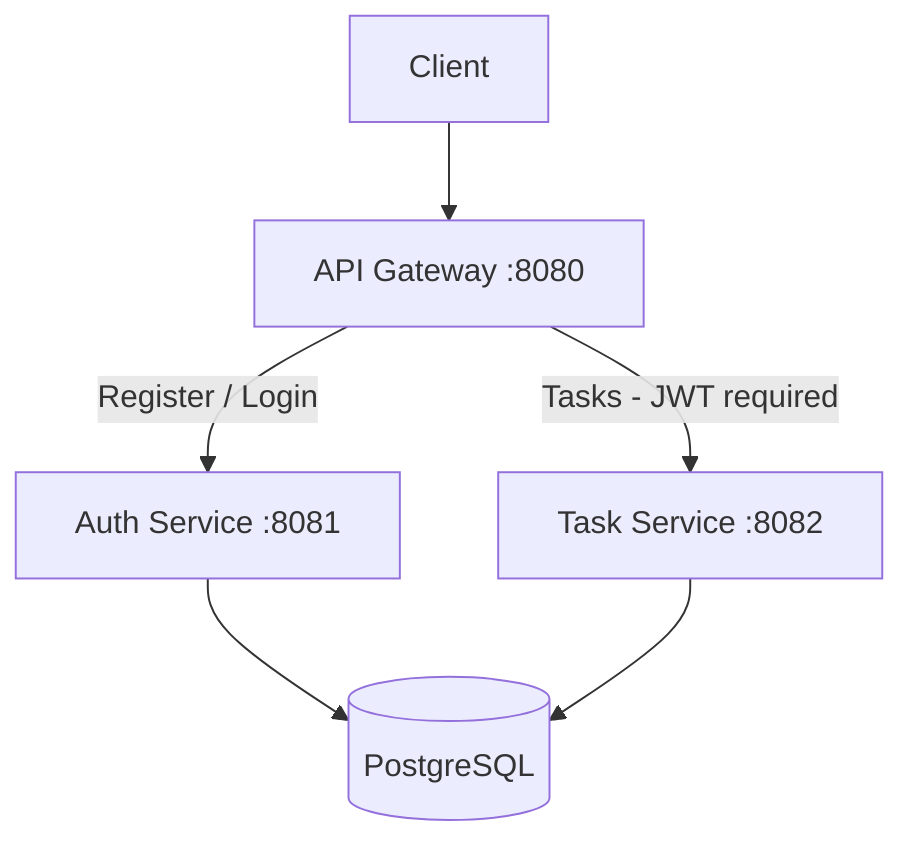

## ## Architecture

The Task Management System was designed using a microservices architecture consisting of three services:

API Gateway: Handles incoming requests, validates JWT tokens, and routes requests to the appropriate service.

Auth Service: Handles user registration and authentication, issuing a JWT token upon successful login.

Task Service: Handles task CRUD operations, ensuring users can only access their own tasks.




## How to Run the Application

### 1. Generate RSA Keys

From the project root, create the keys directory:

```bash
mkdir -p keys
```

Generate the private and public keys:

```bash
openssl genpkey -algorithm RSA -out keys/private.pem -pkeyopt rsa_keygen_bits:2048
openssl pkey -in keys/private.pem -pubout -out keys/public.pem
```

The Auth Service uses the private key to sign JWTs. The API Gateway and Task Service use the public key to validate them.

### 2. Start the Application

Build and start all services:

```bash
docker compose up -d --build
```

Check that the containers are running:

```bash
docker compose ps
```

### 3. Stop the Application

```bash
docker compose down
```

## Integration tests

```bash
docker compose up -d --build
```

```bash
gradle :integration-tests:test --rerun-tasks
```

## API Endpoints

All API requests are routed through the API Gateway.

| Method | Endpoint | Description | Authentication | Success Response | Error Responses |
|--------|----------|-------------|----------------|------------------|-----------------|
| `POST` | `/auth/register` | Register a new user | Public | `201 Created` | `400`, `409` |
| `POST` | `/auth/login` | Authenticate user and obtain JWT | Public | `200 OK` | `400`, `401` |
| `GET` | `/tasks` | List tasks belonging to the authenticated user | Bearer JWT | `200 OK` | `401`, `500` |
| `POST` | `/tasks` | Create a new task | Bearer JWT | `201 Created` | `400`, `401`, `500` |
| `GET` | `/tasks/{id}` | Retrieve a task by ID | Bearer JWT | `200 OK` | `400`, `401`, `404` |
| `PUT` | `/tasks/{id}` | Update an existing task | Bearer JWT | `200 OK` | `400`, `401`, `404` |
| `DELETE` | `/tasks/{id}` | Delete a task | Bearer JWT | `204 No Content` | `400`, `401`, `404` |


